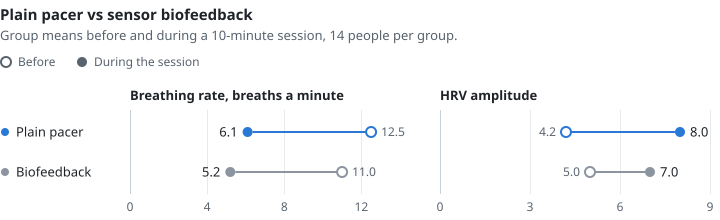
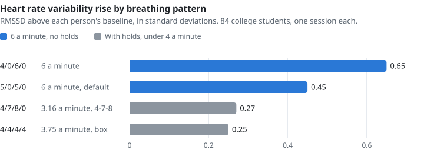
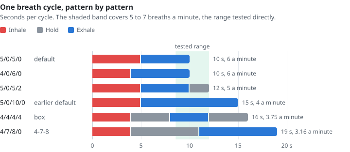

# exhale

A minimal cross-platform breathing overlay: a friendly indicator and reminder to take full, deep breaths while looking at screens.

Demanding work at a keyboard measurably changes how you breathe. Data-entry operators monitored over three 6-hour working days ran significantly *lower* end-tidal CO2 and *faster* respiration during data entry than during relaxation ([Schleifer & Ley 1994](docs/CITATIONS.md#schleifer1994-vdt-petco2)), and a second sample from the same group ran lower end-tidal CO2 again under higher mental workload at the keyboard ([Schleifer et al. 2008](docs/CITATIONS.md#schleifer2008-emg-gaps-computer-work)). Both samples are small and come from one research group, 34 people in all. The same pattern shows up under cognitive load in general: breathing gets faster while depth appears to stay about the same ([Grassmann et al. 2016](docs/CITATIONS.md#grassmann2016-cognitive-load-respiration), 54 experiments, four of which measured end-tidal CO2 and found it lower). So the effect was measured at a keyboard, and nobody has shown the keyboard causes it. A hyperventilation theory of job stress proposes that the pattern involves a shift from diaphragmatic to thoracic breathing ([Schleifer, Ley & Spalding 2002](docs/CITATIONS.md#schleifer2002-hyperventilation-job-stress)), though no study in this corpus has measured that shift in screen users. Posture may add to it. In one small study, people who used a smartphone more than four hours a day had lower peak expiratory flow ([Jung et al. 2016](docs/CITATIONS.md#jung2016-smartphone-posture-respiration)), and three of four comparison studies found forward head posture lowered forced vital capacity (FVC), with reductions of 0.25 to 0.81 L ([Deniz et al. 2024](docs/CITATIONS.md#deniz2024-forward-head-lung-volumes)).

Slow paced breathing is the breathing practice with the most published evidence behind it ([Laborde et al. 2022](docs/CITATIONS.md#laborde2022-vsb-meta) with 223 studies, [Fincham et al. 2023](docs/CITATIONS.md#fincham2023-breathwork-meta) with g = -0.35 for self-reported stress, and [Zaccaro et al. 2018](docs/CITATIONS.md#zaccaro2018-slow-breathing-review)). Whether it counters the over-breathing above is untested, and one study found it can add to it (gap 5 in the [gaps ledger](docs/CITATIONS.md#gaps-and-unsupported-choices)). exhale paces it for you, with no sensor, account or telemetry. In two single-session comparisons, a plain visual pacer at 6 breaths per minute (an expanding circle in the first, a rising and falling ball in the second) raised heart rate variability at least as much as sensor-driven biofeedback ([Tabor et al. 2022](docs/CITATIONS.md#tabor2022-guided-breathing-design), [Laborde et al. 2021](docs/CITATIONS.md#laborde2021-spb-6cpm-biofeedback)). People in the second study rated biofeedback slightly more pleasant, and finding your personal resonance frequency still takes a sensor. For one session's physiological effect, though, the sensor added nothing.

<picture>
  <source media="(prefers-color-scheme: dark)" srcset="docs/charts/pacer-dark.svg">
  
</picture>

<sub>Source: [Tabor et al. 2022](docs/CITATIONS.md#tabor2022-guided-breathing-design)</sub>

Blink rate also falls at a display. In one count it went from 22 a minute at rest to 7 at a screen ([Tsubota & Nakamori 1993](docs/CITATIONS.md#tsubota1993-vdt-blink), [Rosenfield 2011](docs/CITATIONS.md#rosenfield2011-computer-vision-syndrome)), though a later review reports that reading on paper lowers it about as much ([Sheppard & Wolffsohn 2018](docs/CITATIONS.md#sheppard2018-digital-eye-strain)). exhale only paces breathing, so it doesn't help with that.

Each link goes to the source's entry in **[docs/CITATIONS.md](docs/CITATIONS.md)**, with its caveats and, for sources that were read, the passage behind each claim. The [gaps ledger](docs/CITATIONS.md#gaps-and-unsupported-choices) lists fourteen places where exhale ships something the literature doesn't back.

The overlay is a translucent window that expands on inhale and contracts on exhale, and on most setups it floats above your other windows (see [Platform notes](#platform-notes)). If you'd like an ordinary window, the **Display** setting switches it to one (see [Overlay or window](#overlay-or-window)). Inhale, post-inhale hold, exhale, and post-exhale hold durations are all configurable.

**The default is `5` / `0` / `5` / `0`.** Five seconds in and five out with no holds is 6 breaths per minute, the rate at which most of the direct evidence was gathered. The range tested directly runs 5 to 7 breaths per minute, and every rate in it beat spontaneous breathing ([You et al. 2023](docs/CITATIONS.md#you2023-respiratory-frequency)). Average individual resonance frequency sits near 5.5 ([Lehrer & Gevirtz 2014](docs/CITATIONS.md#lehrer2014-hrv-biofeedback)), and one study found 5.5 breaths a minute at an equal ratio beat the other combinations tested, including two at 6 ([Lin et al. 2014](docs/CITATIONS.md#lin2014-equal-ratio-hrv)). In a study comparing four patterns (n = 84), 6 breaths per minute raised heart rate variability more than box breathing or 4-7-8 ([Marchant et al. 2025](docs/CITATIONS.md#marchant2025-square-478-six)). Of its two 6-a-minute ratios, only 4:6 beat the hold patterns significantly on RMSSD, a heart rate variability measure. The default 5:5's lead over them fell short of significance after Scheffé correction, and the two ratios didn't differ significantly from each other. With no holds, it's also an easy place for a beginner to start.

<picture>
  <source media="(prefers-color-scheme: dark)" srcset="docs/charts/patterns-dark.svg">
  
</picture>

<sub>Source: [Marchant et al. 2025](docs/CITATIONS.md#marchant2025-square-478-six), Table 4</sub>

Box breathing is `4` / `4` / `4` / `4` and exhale supports it. The holds make it a 16-second cycle, or 3.75 breaths per minute, so it's slower than it looks. It lost that comparison ([Marchant et al. 2025](docs/CITATIONS.md#marchant2025-square-478-six), whose authors note square and 4-7-8 breathing "have little empirical support"). In a month-long randomized trial, its effect on mood didn't differ significantly from the control's, while cyclic sighing, which stretches the exhale, did ([Balban et al. 2023](docs/CITATIONS.md#balban2023-cyclic-sighing), where the box arm had 21 people and the paper reports no test of one pattern against the other). 4-7-8 is slower still, a 19-second cycle or about 3.2 breaths per minute, and it lost the same comparison.

<picture>
  <source media="(prefers-color-scheme: dark)" srcset="docs/charts/cycles-dark.svg">
  
</picture>

<sub>Tested range from [You et al. 2023](docs/CITATIONS.md#you2023-respiratory-frequency), 4-7-8 timing from [Marchant et al. 2025](docs/CITATIONS.md#marchant2025-square-478-six), the rest from exhale's presets</sub>

**On making the exhale longer than the inhale:** treat it as a preference. Studies split on whether a longer exhale raises heart rate variability more than an equal or shorter one. Three found an effect ([Bae et al. 2021](docs/CITATIONS.md#bae2021-exhalation-inhalation-ratio), [Van Diest et al. 2014](docs/CITATIONS.md#vandiest2014-ie-ratio-relaxation), [Laborde et al. 2021](docs/CITATIONS.md#laborde2021-ie-ratio-pauses)), one found the equal ratio better ([Lin et al. 2014](docs/CITATIONS.md#lin2014-equal-ratio-hrv)), and two found no significant difference. Of those two, one compared 4:6 with 5:5 at 6 breaths per minute ([Marchant et al. 2025](docs/CITATIONS.md#marchant2025-square-478-six)) and the other ran an experiment plus its own replication ([Meehan & Shaffer 2024](docs/CITATIONS.md#meehan2024-longer-exhalations)). Meehan & Shaffer's review of older work adds three more nulls (one didn't measure heart rate variability), one more result favoring a longer exhale and one favoring a longer inhale. With results this mixed, exhale doesn't claim any mechanism behind it.

The evidence on how a longer exhale feels is thin and mixed. One study of 23 people found a longer exhale produced more reported relaxation, stress reduction, mindfulness and positive energy than a longer inhale, while slowing the rate alone moved only one of those four ([Van Diest et al. 2014](docs/CITATIONS.md#vandiest2014-ie-ratio-relaxation)). A larger one, 84 people, measured mood across both ratios at 6 breaths per minute and found no change at either ratio ([Marchant et al. 2025](docs/CITATIONS.md#marchant2025-square-478-six)), and a third found *every* slow pattern beat baseline on relaxation ([Lin et al. 2014](docs/CITATIONS.md#lin2014-equal-ratio-hrv)). A month-long trial favors an exhale-heavy pattern for mood ([Balban et al. 2023](docs/CITATIONS.md#balban2023-cyclic-sighing)), though its cyclic-sighing arm also adds a double inhale, and its inhale-heavy arm had a slightly larger raw gain that didn't separate from the control's. Prefer a longer exhale if it feels better to you.

The tested range only tells you which rates were studied. Resonance frequency varies from person to person, and taller people and men tend to have lower ones ([Lehrer & Gevirtz 2014](docs/CITATIONS.md#lehrer2014-hrv-biofeedback)), so no single default suits everyone. Treat 6 a minute as a starting point and adjust from there. exhale's earlier default, `5` in / `10` out at 4 breaths per minute, is still one click away as a preset. No primary study in this corpus has measured 4 a minute. The one report is secondhand: [Lehrer 2022](docs/CITATIONS.md#lehrer2022-my-life-hrvb) recalls a 2003 pacing study from his own group that found heart rate variability amplitude highest at 4 and 6 a minute. All of this, including the arithmetic, is laid out in [the gaps ledger](docs/CITATIONS.md#gaps-and-unsupported-choices).

A review of 223 studies of slow breathing remarks that "very few adverse effects are reported" in them, though it didn't collect adverse-event data ([Laborde et al. 2022](docs/CITATIONS.md#laborde2022-vsb-meta)). The timing controls also reach fast, hold-heavy patterns. In a trial of fast breathing with long holds, light-headedness came up in both the fast arm and its slower comparison arm, and tetany, tingling with loss of finger control, in the fast arm only ([Fincham et al. 2024](docs/CITATIONS.md#fincham2024-high-ventilation-rct)). Slow down or stop if you feel either.

## Disclaimer

The information and guidance provided by this app are intended for general informational purposes only and aren't medical advice. The creator isn't a medical professional. Always seek the advice of a qualified healthcare provider with any questions about your health, and don't disregard or delay professional medical advice because of this app. Use is at your own risk.

## What to expect

**How long before it does anything.** In a lab comparison, HRV changes appeared mostly within the first two
minutes of a paced session ([Tabor et al. 2022](docs/CITATIONS.md#tabor2022-guided-breathing-design)). Expect the effect
to last about as long as the pacer runs. The one study of an ambient on-screen pacer during real
information work found breathing slowed while the pacer ran, with no lasting change afterwards
([Moraveji et al. 2011](docs/CITATIONS.md#moraveji2011-peripheral-paced-respiration)). The trial that
reported mood gains over a month used five minutes a day
([Balban et al. 2023](docs/CITATIONS.md#balban2023-cyclic-sighing)). Running exhale all day is fine too.

**If you use the reminder timer instead of the always-on overlay.** Breaks of ten minutes or less
had small effects on self-reported fatigue and vigor ([Albulescu et al. 2022](docs/CITATIONS.md#albulescu2022-micro-breaks), 22
independent study samples), and self-reported relief is higher after a single instructed deep breath than before it
([Vlemincx et al. 2016](docs/CITATIONS.md#vlemincx2016-sigh-relief)). That's the closest published support for
a single reminder to breathe.

**Breathe through your nose.** exhale can't cue this, so it's up to you. In recordings
from epilepsy patients, nasal breathing entrained oscillations in piriform cortex and drove activity
timed to each inhale in the amygdala and hippocampus, and the effects diminished when breathing moved
to the mouth ([Zelano et al. 2016](docs/CITATIONS.md#zelano2016-nasal-respiration-limbic)).

**Why breathing might affect how you feel.** Heart rate rises on inhalation and falls on
exhalation ([Yasuma & Hayano 2004](docs/CITATIONS.md#yasuma2004-rsa)), which is the coupling every HRV claim here
rests on. Separately, a small population of neurons in the mouse breathing rhythm generator projects
onto the locus coeruleus, and ablating them left breathing intact while increasing calm behavior
([Yackle et al. 2017](docs/CITATIONS.md#yackle2017-breathing-arousal-neurons)). That's a plausible route from
breathing pattern to arousal state. It's a mouse study, so it suggests a mechanism without showing
one in people.

## Research and evidence

[docs/CITATIONS.md](docs/CITATIONS.md) traces exhale's design to 49 sources: 46 verified against the Crossref REST API, 2 against Open Library and 1 against PubMed. It keeps the published dissent next to the support. On blood pressure, a meta-analysis finds sustained slow breathing lowers systolic pressure by 5.62 mmHg ([Chaddha et al. 2019](docs/CITATIONS.md#chaddha2019-slow-breathing-bp)), while a letter in a hypertension journal argues the case for device-guided slow breathing should be considered closed ([van Dijk et al. 2018](docs/CITATIONS.md#vandijk2018-close-the-book)). In one trial, 20-second breaks from a screen task, the kind of nudge exhale gives, produced no significant effect on symptoms, reading speed or accuracy ([Johnson & Rosenfield 2023](docs/CITATIONS.md#johnson2023-20-20-20)). In one small comparison, audio pacing was rated more calming than visual, and the visual guide's larger change in breathing was only a trend ([Wongsuphasawat et al. 2012](docs/CITATIONS.md#wongsuphasawat2012-cant-force-calm)). exhale is visual-only so it can sit silently on a working screen, and that may make it less calming.

exhale's four-phase inhale / hold / exhale / hold structure comes from pranayama ([Satyananda Saraswati 1999](docs/CITATIONS.md#satyananda1999-apmb), [Muktibodhananda 1998](docs/CITATIONS.md#muktibodhananda1998-hatha-yoga-pradipika)) and is centuries older than any heart rate variability study. Breathing apps got the longer-exhale idea from pranayama too, long before any lab tested it.

[`docs/for-researchers.md`](docs/for-researchers.md) is a reference for a lab considering exhale as a study stimulus. It covers the parameters and defaults, study mode, which locks a participant's pacing from a `study.toml` file, the session log and the limits of the evidence. [`CITATION.cff`](CITATION.cff) has the software's own citation.

## Download

Linux `.deb` and AppImage packages are on the [Releases](https://github.com/peterklingelhofer/exhale/releases) page, and Mac and Windows install from their app stores. Using the latest release is recommended. If you hit a problem, please [open an issue](https://github.com/peterklingelhofer/exhale/issues/new).

**Mac**

[</img>](https://apps.apple.com/us/app/exhale-breath/id6447758995?mt=12)

**Windows**

[](https://apps.microsoft.com/detail/9p79z1njmzb3)

You can also build the standalone `.exe` from source (see [Build & run](#build--run)).

**Linux**

[](https://snapcraft.io/exhale-app)

You can also build from source (see [Build & run](#build--run)).

## Usage


The Timing card has five one-click presets and shows the breathing rate of the current timing next to the range tested directly, so a timing outside that range is flagged as you choose it. **Research**, in the tray menu and in the macOS app menu under About, opens the [sources page](https://peterklingelhofer.github.io/exhale/citations.html), which always shows the latest `docs/CITATIONS.md`.

### Overlay or window

The **Display** row in the Appearance card picks one of two modes, and a change takes effect at once.

- **Overlay** is the default. One translucent window per monitor floats above your other windows and lets clicks through.
- **Window** is one regular window named "exhale" that you can move, resize or make full screen. It remembers its size and position, shows up in Alt-Tab and the taskbar or Dock, and leaves your other windows alone.

In Window mode, Stop and the window's close button hide the window, and Start brings it back. To quit, use **Quit** in the settings panel or **Quit exhale** in the tray menu. The window draws your colors at full strength, so the Overlay Opacity row is disabled while it shows. Where exhale can't draw a see-through overlay, the Display row is locked to Window (see [Platform notes](#platform-notes)).

### Global keyboard shortcuts

Global shortcuts work in every build except on a Wayland session, where Linux gives apps no way to listen for keys globally. One shortcut is bound by default:

| Shortcut                                    | Action                 |
|---------------------------------------------|------------------------|
| <kbd>Ctrl</kbd>+<kbd>Shift</kbd>+<kbd>,</kbd> | Open / close Preferences |

Every other action (Start / Stop / Reset / Quit) is **unbound** on first launch so exhale never collides with another app's global shortcut without the user opting in. Customize via either path:

- **Right-click** the Start / Stop / Reset / Quit buttons in the Preferences panel -> "Change Shortcut…" -> press your combo
- **Tray menu** -> "Keyboard Shortcuts ▶" -> pick any of the five actions to start a capture

Press **Esc** in the capture overlay to cancel. "Reset Shortcut to Default" in the right-click menu restores the per-action factory value (which, for everything except Preferences, is "unbound"). Reset to Defaults in the panel clears all custom bindings too.

**Notice:** A high opacity value can obscure the Preferences pane in the current workspace. Reset to Defaults in the menu-bar or tray menu recovers from it. To keep your other settings instead:

1. Swipe to a different workspace.
2. Close Preferences from the menu bar or tray.
3. Re-open Preferences in the current workspace and adjust Opacity.
4. Switch back.

## Build & run

From `rust/`, with Rust installed:

```sh
cargo run --release
```

The binary lands in `rust/target/release/exhale` (`exhale.exe` on Windows). Drop `--release` for a faster debug build while you work on the code. [LEARNING.md](LEARNING.md) is a beginner's tour of the codebase, and [DEPLOYMENT.md](DEPLOYMENT.md) covers signing, packaging and the store uploads.

macOS and Windows need nothing beyond Rust, and Windows works with both the MSVC and GNU toolchains. Linux needs a few system libraries. On Debian or Ubuntu:

```sh
sudo apt install \
    libgtk-3-dev libayatana-appindicator3-dev \
    libwayland-dev libxkbcommon-dev libxdo-dev \
    libssl-dev pkg-config
```

On Fedora or RHEL:

```sh
sudo dnf install \
    gtk3-devel libayatana-appindicator-gtk3-devel \
    wayland-devel libxkbcommon-devel libxdo-devel \
    openssl-devel pkgconf-pkg-config
```

To only run a prebuilt binary, the runtime packages without the `-dev` suffixes are enough:

```sh
sudo apt install libgtk-3-0 libayatana-appindicator3-1 libwayland-client0 libxkbcommon0 libxdo3 libssl3
```

## Settings

Settings save as you change them, to a TOML file:

| Platform | Path |
|----------|------|
| macOS (dev / standalone) | `~/Library/Application Support/com.peterklingelhofer.exhale/settings.toml` |
| macOS (Mac App Store)    | `~/Library/Containers/peterklingelhofer.exhale/Data/Library/Application Support/com.peterklingelhofer.exhale/settings.toml` |
| Windows  | `%APPDATA%\peterklingelhofer\exhale\config\settings.toml` |
| Linux    | `~/.config/exhale/settings.toml`, or `$XDG_CONFIG_HOME/exhale/settings.toml` when `XDG_CONFIG_HOME` is set |

The Mac App Store build runs sandboxed, so its file lives in the app's container. A file that can't be parsed is rewritten with the defaults. A `study.toml` beside `settings.toml` locks the pacing, appearance and display fields for a study, covered in [`docs/for-researchers.md`](docs/for-researchers.md).

## Platform notes

- **macOS**: the overlay floats above full-screen apps, shows on every Space and stays out of Cmd+Tab.
- **Windows**: tested on and recommended for Windows 11. Some Windows 10 graphics drivers can't draw a see-through overlay, and exhale shows a window there instead.
- **Linux (X11)**: the overlay stays on top, lets clicks through and shows on every workspace.
- **Linux (Wayland)**: Wayland has no standard way for an app to keep an overlay on top, so exhale always shows a window. Stop leaves that window in place, blank, because Wayland doesn't let an app hide its own window. For the full overlay, pick an X11 session at the login screen.

exhale also shows a window under the Microsoft Basic Render Driver (WARP) and over remote desktop. To use the window as an edge strip, send it behind your other apps, set **Shape** to Rectangle, and narrow the windows in front so the animation shows around them.

## Minimal Python script fallback

If the Snap doesn't suit your distro (Alpine, NixOS, immutable distros), or you'd rather tweak constants at the top of a 200-line Python file, there's a single-file script:


```sh
git clone https://github.com/peterklingelhofer/exhale.git
cd exhale/python
python main.py
```

Modify the constants at the top of [`python/main.py`](python/main.py) for inhale/exhale duration in seconds, shape mode, and full-screen toggle.

**The Rust binary is the recommended path on every supported OS, including Wayland** (see [Platform notes](#platform-notes)). The Python script is here for hacking on.

## Companion repository

A Perl version of this exists at <https://github.com/franco3445/Breathing>.

---

## Deprecated implementations

<details>
<summary>The original Swift app and the Electron app, kept for reference only</summary>

The Rust port supersedes both, and they won't receive new features or fixes.

**Swift macOS app (`swift/`).** The original macOS-only implementation, written in SwiftUI + Metal. The Rust port has the same overlay and settings, adds Windows and Linux, and uses less CPU. The Mac App Store now ships the Rust build.

```sh
git clone https://github.com/peterklingelhofer/exhale.git
cd exhale/swift
xed .
```

**TypeScript / Electron app (`typescript/`).** Cross-platform Electron build that predates the Rust port. The Rust binary covers macOS, Windows and Linux from a single ~10 MB native executable, without the Chromium runtime Electron bundles. The Electron app's settings live in `localStorage` and have to be edited via DevTools, while the Rust port has a settings panel.

```sh
git clone https://github.com/peterklingelhofer/exhale.git
cd exhale/typescript
pnpm install
pnpm start
```

To recompile automatically with [electron-reload](https://github.com/yan-foto/electron-reload):

```sh
pnpm watch
```

</details>
